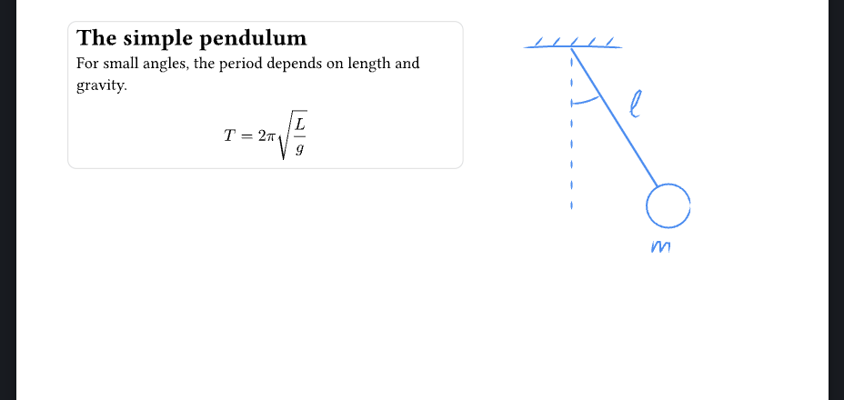

  <picture>
    <source media="(prefers-color-scheme: dark)" srcset="brand/mark-dark.svg">
    
  </picture>

<h1 align="center">Goodtype</h1>

A technical notebook for handwriting, equations and code.

<a href="https://github.com/goodtype-notes/Goodtype/releases">Download for Windows</a> · <a href="handbook/notebooks.md">Notebook guide</a> · <a href="handbook/development.md">Build from source</a>

Sketch a graph with the pen. Set its equation in Typst. Keep the calculation on a Jupyter page in the same notebook. Export everything to PDF with vector ink and selectable text.

Goodtype saves ordinary files on your device. Writing, typesetting and exporting work offline without an account.

**Windows 10 and 11 · Early development.** Extract the full release ZIP and open `Goodtype.exe`. The Windows package is unsigned. Keep a separate copy of important notebooks while the format evolves.

### Documentation

[Write, select and export](handbook/notebooks.md) · [Import and store notebooks](handbook/files.md) · [Build and contribute](handbook/development.md)

### Branches and releases

Contributions target `dev`. Each Windows candidate is tested before promotion to `main`. [Contributor workflow](handbook/development.md#branches-and-releases)

[Apache License 2.0](LICENSE) · [Third party notices](NOTICE)
