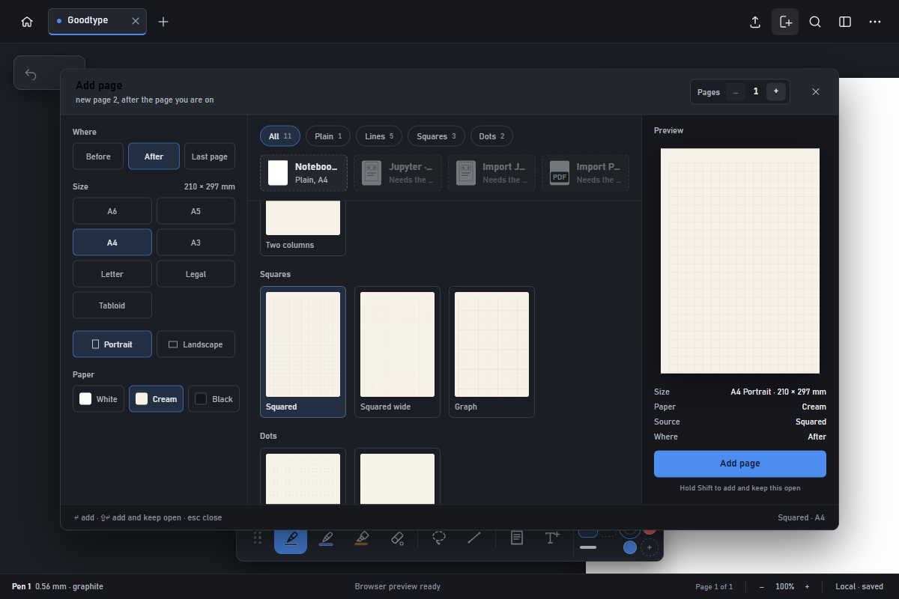
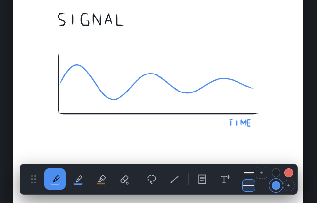
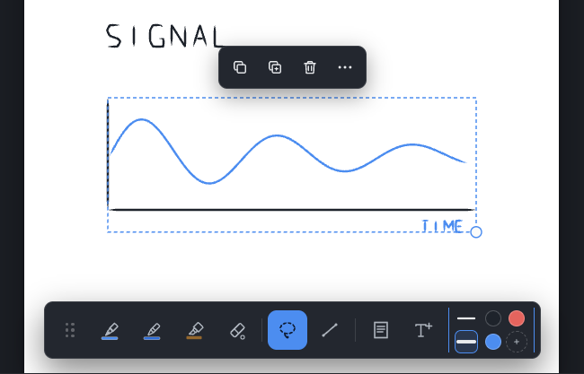
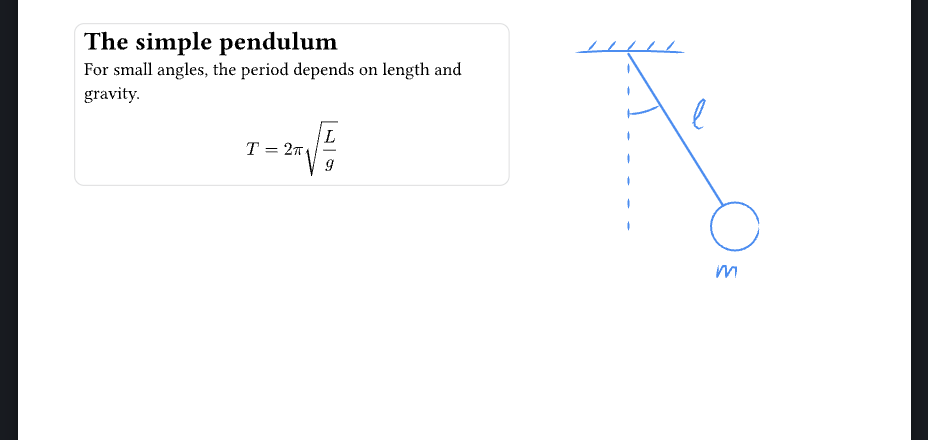

[Goodtype](../README.md) / Notebook guide

# Your first notebook

Open the Library, choose a folder for your notebooks and create a notebook. Open **Add page** to choose the paper size, orientation, colour and ruling. Squared paper works well for graphs. Plain paper leaves room for diagrams.

## Draw and select

Pick a pen, choose a colour and draw on the page. Pen width responds to pressure on supported hardware. Pens and shapes also support dotted and dashed lines. In this example, the axes and the oscillation are separate strokes.

Choose **Lasso select** and draw a loop around the graph. Drag the selection to move it as one object. Open the lasso options to choose which kinds of objects to include when a selection contains handwriting, highlights, shapes, images or Typst.

## Typeset an equation

Choose **New Typst block** to place an equation beside your sketch. Enter ordinary Typst source, such as `$ T = 2 pi sqrt(L / g) $`. Drag a corner to scale the result or a side to change the width and reflow the text. If a source edit fails to compile, the previous rendering stays on the page. Use **Page text** for longer passages that follow the paper ruling.

Goodtype includes the Typst compiler, fonts and the Tinymist editor helper. Installed fonts also work in preview and export.

On Windows, select handwriting and choose **Transcribe** to use an installed text recognizer. Review the proposed text and insert it as an editable Typst block. The ink stays on the page.

## Add a calculation

In **Add page**, choose a Jupyter page or import an `.ipynb` file. Add Python or Markdown cells and press **Run** to execute Python. Choose a compatible local interpreter or install the optional scientific runtime. Opening a notebook or exporting it never runs a cell.

Continue a calculation on another page to share variables. Python can use relative paths in its temporary session directory. Save any data or generator you need again in the cell source. Restarting the session clears temporary files.

## Extend your notebook

Open **Settings** and choose **Addons** to browse optional tools and content such as engineering symbols and study templates. Review the source and permissions shown for a release before installing it.

If you use an external AI assistant, you can grant it access to selected notebook material through Goodtype's local relay. Review its proposal before inserting it. The assistant controls what it sends to its own provider. [Relay setup](../crates/goodtype-mcp/README.md)

## Export the notebook

Arrange pages in the order you want to read them, then choose **Export PDF**. Export uses the saved pages, including their images, PDF material and calculation outputs. Calculation pages can retain their full height or split into A4 sheets.

*The pendulum demo uses the Windows desktop app with its embedded Typst compiler. The graph and paper picker use the frontend preview. Both use sample content and simulated pen input.*

[Import and store notebooks](files.md)
